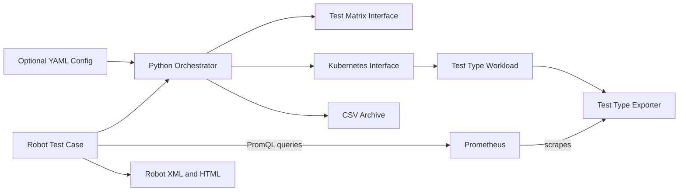
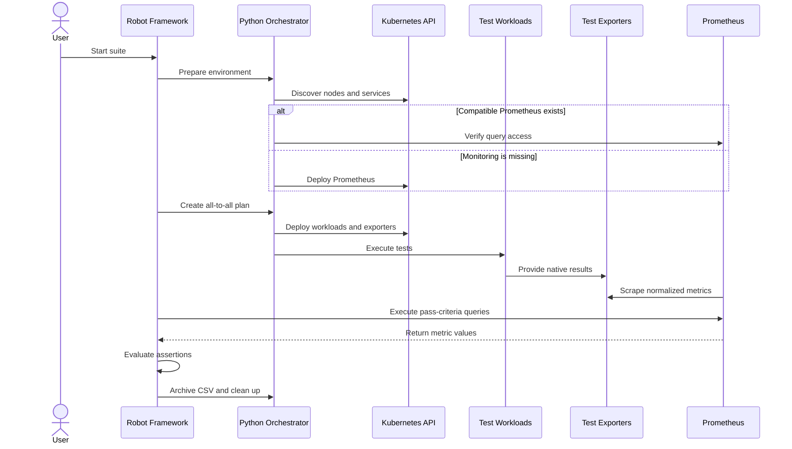
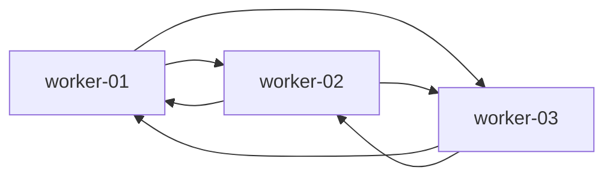

# test-orchestrator

## Overview

Test orchestration framework for functional and non-functional validation of Kubernetes clusters.

Main goals:

- Local Python-based orchestration
- Robot Framework as the primary test interface
- Automatic Kubernetes discovery
- Node-to-node test execution
- Self-deployment of required components
- Optional integration with an existing Prometheus
- YAML configuration where discovery is not sufficient
- Common interfaces for different test types
- Human-readable pass criteria backed by PromQL queries
- Health Checks before starting tests
- Automatic value discovery if not clearly defined in robot or YAML (KUBECONFIG, etc)
- Documentation
    - User Guide 
    - How Tos (Contribution Guide, Where is what, ...)

        

Initial focus:

- Single Kubernetes cluster
- `iperf2`
- Pod-to-pod tests across nodes
- All-to-all test matrices

Future extensions:

- `IRTT`
- `TRex`
- Kubernetes Operator
- Multi-cluster tests
- Historical comparisons

## Motivation

Existing tools cover parts of the required workflow:

- `k8s-netperf`
  - Kubernetes network benchmarks
  - Multiple traffic generators
- `Testkube`
  - General test execution and workflow orchestration
- `ClusterLoader2` and `kube-burner`
  - Kubernetes load and scalability tests
- `K-Bench`
  - Control-plane and data-plane benchmarks

### Identified Gap

Required combination:

- Lightweight local execution
- No mandatory external control plane
- Self-deployment of test and monitoring components
- Use of an existing Prometheus when available
- Automatic node discovery and placement
- Configurable node-to-node test matrices
- Robot Framework as user-facing test definition
- Human-readable validation criteria
- Prometheus as common metrics and query interface
- Extensible test types and exporters
- CSV archive for later database storage
    - interface for multiple storage solution
- Future cluster-to-cluster support

The project acts as an abstraction layer between Robot Framework, Kubernetes test workloads, exporters and Prometheus.

## Interfaces



### Test Definition Interface

Supported inputs:

- Robot Framework test suites
- Robot variables
- Optional YAML configuration
- Automatically discovered cluster information

Preferred first implementation:

- Robot suite performs setup, execution and validation
- YAML remains optional for reusable configuration

### Python Orchestrator Interface

Responsibilities:

- Connect to the cluster
- Discover nodes and services
- Resolve node selectors
- Build test matrices
- Deploy required components
- Execute and monitor tests
- Query Prometheus
- Archive normalized results
- Clean up run-owned resources

Reusable later by:

- CLI
- CI/CD pipelines
- Kubernetes Operator
- External API

### Test Type Interface

Every test type defines:

- Required images
- Client and server workloads
- Supported parameters
- Start and stop behavior
- Exporter implementation
- Available metrics
- Cleanup behavior

Examples:

- `iperf2`
- `iperf3`
- `IRTT`
- `TRex`

### Exporter Interface

Every test type provides a dedicated exporter. In addition to the test type specific exporter, it also uses the [prometheus node exporter](https://github.com/prometheus/node_exporter) for node specific metrics. 

Responsibilities:

- Parse native tool results
- Expose normalized Prometheus metrics
- Preserve useful tool-specific metrics
- Report completed, failed and incomplete tests

Required labels:

- `run_id`
- `test_id`
- `test_type`
- `source_node`
- `target_node`
- `source_pod`
- `target_pod`
- `cpu_id`
- `protocol`
- `start_time`

Example normalized metrics:

```text
test_orchestrator_test_completed
test_orchestrator_execution_errors_total
test_orchestrator_throughput_bits_per_second
test_orchestrator_packet_loss_percent
test_orchestrator_jitter_seconds
test_orchestrator_latency_seconds
```

Not every test type must provide every metric. Supported capabilities must be checked before execution.

### Validation Interface

Human-readable Robot keywords map to PromQL queries.

```text
Packet Loss Should Be 0 Percent
    -> query packet loss for every test pair
    -> assert that every value equals 0

Maximum Latency Should Be 10 Microseconds
    -> query maximum latency for every test pair
    -> assert that every value is at most 10 µs
```

Benefits:

- Same validation style for different test types
- Visible and reproducible pass criteria
- Common evaluation of test and infrastructure metrics
- Future support for historical PromQL queries

## Deployment



### Monitoring Modes

#### Managed

- Deploy required Prometheus components
- Deploy required exporters
- Configure scraping automatically
- Label resources with run ownership
- Optional cleanup after the run

#### Existing

- Use a configured Prometheus endpoint
- Detect an in-cluster instance where possible
- Verify authentication and query access
- Expose test exporters for scraping
- Do not modify unrelated resources

#### Auto

- Prefer an existing compatible installation
- Deploy a managed instance when required

## Test Matrix

Supported modes:

- `one-to-one`
  - User defines every source and target
- `one-to-many`
  - User defined source and multiple defined or number of targets
- `many-to-one`
  - User defined multiple sources and one defined target
- `all-to-all`
  - Every selected node tests every other selected node
- `one-to-all`
  - One source tests all selected targets
- `all-to-one`
  - All selected sources test one target

Node selection:

- Exact node name
- Kubernetes labels
- Topology labels
- Automatic selection

Example for three nodes:



Same-node pairs are excluded by default.

## Configuration

Configuration sources:

- Robot test case
- Robot variables
- Optional YAML file
- Cluster discovery

### YAML Example

```yaml
apiVersion: test-orchestrator/v1alpha1
kind: NetworkTest

metadata:
  name: all-to-all-1g

execution:
  matrix: all-to-all
  repetitions: 1
  cleanup: true

placement:
  nodeSelector:
    node-role.kubernetes.io/worker: ""
  excludeSameNode: true

test:
  type: iperf2
  protocol: udp
  duration: 30s
  targetBandwidth: 1G

monitoring:
  mode: auto
  existingPrometheusUrl: null

validation:
  packetLossPercent:
    equals: 0
  throughputMbps:
    min: 950
  latencyMicroseconds:
    max: 10
  jitterMicroseconds:
    max: 20

results:
  directory: ./results
  archiveCsv: true
```

### Robot Example

The Robot file should expose only the parameters and pass criteria required by the user.
Deployment, Prometheus queries, result handling and cleanup are implemented in the imported resource and Python library.

```robot
*** Settings ***
Documentation       Minimal example for a 1 Gbit/s all-to-all network test.
Resource            resources/TestOrchestrator.resource

Suite Setup         Prepare Test Environment    prometheus=auto
Suite Teardown      Archive Results And Cleanup


*** Variables ***
# Traffic parameters
${TEST_TYPE}             iperf2
${PROTOCOL}              udp
${TEST_MATRIX}           all-to-all
${NODE_SELECTOR}         node-role.kubernetes.io/worker
${TARGET_BANDWIDTH}      1G
${TEST_DURATION}         30s


*** Test Cases ***
1G All-To-All Network Test
    Run Network Test
    ...    type=${TEST_TYPE}
    ...    protocol=${PROTOCOL}
    ...    matrix=${TEST_MATRIX}
    ...    node_selector=${NODE_SELECTOR}
    ...    bandwidth=${TARGET_BANDWIDTH}
    ...    duration=${TEST_DURATION}

    Packet Loss Should Be           0      percent
    Minimum Throughput Should Be    950    megabits per second
    Maximum Latency Should Be       10     microseconds
    Maximum Jitter Should Be        20     microseconds
```

Intended usage:

- Traffic configuration remains visible and editable
- One test case starts the complete test matrix
- Each pass criterion is one human-readable line
- PromQL queries and assertion logic remain hidden
- Robot output and CSV archiving are handled by shared keywords

Suggested implementation split:

```text
all-to-all-1g.robot
resources/TestOrchestrator.resource
libraries/TestOrchestratorLibrary.py
```

## Metrics

### Test Metrics

- Completion state
- Execution errors
- Throughput
- Packet loss
- Number of packets
- Jitter
- Latency, where supported
- Transferred bytes
- Duration

### Supporting Metrics

Pod metrics:

- CPU and memory usage
- used CPU and memory
- Network throughput
- Container restarts
- Scheduling and readiness

Node metrics:

- CPU and memory usage
- used CPU and memory
- Network throughput
- Interface throughput
- Packet drops
- Interface errors
- Node conditions

### Metric Rules

- Exporters normalize names and units
- Test types publish their metric capabilities
- Unsupported criteria fail before execution
- Missing metrics after execution are test errors

## Verifications

Pass criteria may be defined through YAML, Robot variables or directly as readable Robot keywords.

### YAML Style

```yaml
validation:
  packetLossPercent:
    equals: 0
  latencyMicroseconds:
    max: 10
```

### Variable Style

```robot
*** Variables ***
${MAX_PACKET_LOSS}    0
${MAX_LATENCY}        10
```

### Human-Readable Style

```robot
Packet Loss Should Be        0     percent
Maximum Latency Should Be    10    microseconds
Maximum Jitter Should Be     20    microseconds
```

The keyword implementation is not part of the user-facing test file.
Each keyword maps internally to a PromQL query and evaluates all matching source-target pairs.

Result artifacts:

- `output.xml`
- `log.html`
- `report.html`
- Normalized CSV archive for later database storage

## Roadmap

### Phase 0:
- Deploy the kube-prometheus-stack to the cluster if no prometheus is already deployed
- Deploy one sender pod and one receiver pod with running `iperf2`
- Get the metrics from the sender and receiver
- Evaluate the metrics

### Phase 1: Robot-Driven Single-Cluster Test

- Minimal Robot suite as primary user interface
- Shared Robot resource file and Python library
- Single cluster
- `iperf2` all-to-all test
- Node selection by name and labels
- Managed, existing and auto Prometheus modes
- Dedicated `iperf2` exporter
- Common metric names and labels
- Human-readable pass criteria with hidden PromQL mappings
- Robot XML and HTML results
- CSV archive
- Automatic cleanup

### Phase 2: Stable Interfaces

- Versioned Python orchestration interface
- Versioned test type interface
- Versioned exporter and metric interface
- Capability discovery
- Versioned YAML schema
- Reusable Robot resource files
- Clear failure and error categories

### Phase 3: Additional Test Types

- `IRTT`
- `TRex`
- Dedicated exporters
- Shared validation keywords
- Tool-specific parameters

### Phase 4: Evaluation and Storage

- Repetitions and aggregation
- Historical baselines
- Regression detection
- Result database
- Dashboards
- Scheduled runs

### Phase 5: Kubernetes Operator

- Custom Resource Definitions
- In-cluster controller
- Reuse existing Python and test type interfaces
- Kubernetes status and result resources

### Phase 6: Multi-Cluster

- Cluster-to-cluster execution
- Multiple kubeconfigs and contexts
- Cross-cluster endpoint selection
- Connectivity and security model
- Multi-cluster test matrices

## Open Questions

### Multi-Cluster Connectivity

Possible future strategies:

- Pod IP
- Kubernetes Service
- NodePort
- LoadBalancer
- Host network
- Multi-cluster CNI
- External interfaces

### Prometheus Integration

To be refined:

- Detection
- Authentication
- Dynamic scrape configuration
- Metric retention
- Temporary or permanent managed deployment

### Execution Strategy

To be refined:

- Sequential or parallel tests
- Maximum concurrency
- Resource isolation
- Repetition and aggregation
- Partial failures

## Related Projects

- [k8s-netperf](https://github.com/cloud-bulldozer/k8s-netperf)
- [Testkube](https://github.com/kubeshop/testkube)
- [ClusterLoader2](https://github.com/kubernetes/perf-tests/tree/master/clusterloader2)
- [K-Bench](https://github.com/vmware-tanzu/k-bench)
- [Robot Framework](https://robotframework.org/)
- [Prometheus](https://prometheus.io/)
