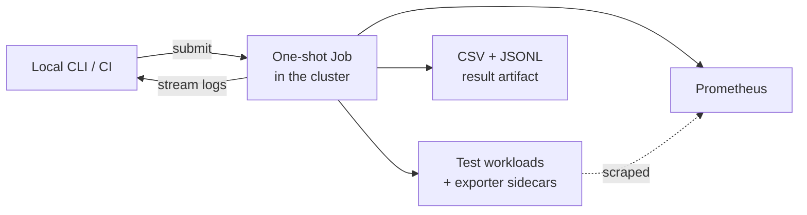
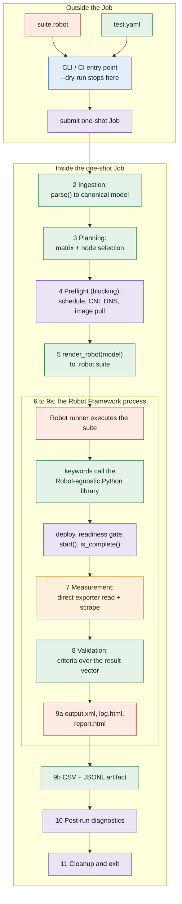

# dokimi

Test orchestration framework for functional and non-functional validation of Kubernetes clusters.

A run deploys a pair of workloads onto two chosen nodes, generates traffic between them, collects
normalized metrics, evaluates human-readable pass criteria against those metrics, writes a result
artifact, and removes everything it created.

## Contents

- [Execution model](#execution-model)
- [The phases of a run](#the-phases-of-a-run)
- [Using the CLI](#using-the-cli)
- [Authoring a test](#authoring-a-test)
- [Validation criteria](#validation-criteria)
- [Metric contract](#metric-contract)
- [Results](#results)
- [Safety and cleanup](#safety-and-cleanup)
- [Interfaces](#interfaces)
- [Container images](#container-images)
- [Development](#development)
- [Milestones](#milestones)
- [Not yet decided](#not-yet-decided)
- [Related projects](#related-projects)

The guides in [`docs/`](docs/) cover the practical side: [installation](docs/installation.md),
[usage](docs/usage.md), [development setup](docs/setup.md) and [building](docs/building.md).
The [test suite's README](tests/README.md) explains what is tested and how to run a subset.

## Execution model

**The orchestrator runs inside the cluster as a one-shot Job, submitted from outside.**

A local CLI (or a CI entry point) validates the test definition, renders the Job manifest and
submits it. The Job carries the full orchestration logic — discovery, planning, preflight, workload
deployment, execution, metric collection, evaluation, result writing and cleanup — runs to
completion, and streams its logs back to whoever submitted it.

Three properties follow, and they are the point of the design:

- **Nothing is permanently installed between runs.** A Job is not a controller; once it exits, the
  cluster is as it was.
- **The Job is unaffected if the submitter disconnects.** It is a server-side resource, not
  something tied to the client's connection. The CLI can reattach to an already-running Job and
  resume streaming, using the run's ownership labels to find it — this works identically for an
  interactive invocation and for CI re-checking a run it submitted earlier.
- **`--dry-run` never submits anything.** It renders the planned matrix and manifests using local
  discovery only (or a provided kubeconfig for read-only cluster info) and stops.



## The phases of a run

A run has twelve phases. This table is the shared vocabulary the rest of this document uses; when
something says "phase 4", this is what it means.

| # | Phase | What happens | Primary tooling |
| --- | --- | --- | --- |
| 0 | Authoring | The user writes a `.robot` suite or a YAML document | Robot syntax or YAML, nothing executes |
| 1 | Submission | CLI or CI renders manifests, submits the one-shot Job, streams logs, can reattach. `--dry-run` stops here | plain Python, Kubernetes client |
| 2 | Ingestion | `parse(source)` into the canonical model, configuration precedence, schema validation | plain Python. Robot's parsing API is used **only** inside the Robot format plugin |
| 3 | Planning | Matrix construction, node selection, concurrency plan | plain Python |
| 4 | Preflight | Prometheus query access, scheduling, CNI connectivity, DNS, image pull, node count against the planned matrix. **Blocking** | plain Python, Kubernetes client, Prometheus |
| 5 | Suite rendering | `render_robot(canonical model)` produces the `.robot` suite that is actually executed | plain Python renderer emitting Robot syntax |
| 6 | Execution | Robot's runner executes the suite. Its keywords call the Robot-agnostic library: deploy workloads, readiness gate, `start()`, `is_complete()` | **Robot Framework runner**, plain Python resource library, Kubernetes client, test-type plugins |
| 7 | Measurement | The sidecar exporter publishes normalized metrics, read directly and also scraped | plain Python, exporters, Prometheus |
| 8 | Validation | Canonical criteria evaluated over the result vector; an empty result fails | plain Python assertion layer, invoked from a Robot keyword |
| 9a | Native reporting | `output.xml`, `log.html`, `report.html` | **Robot Framework**, as a side effect of phase 6 |
| 9b | Result artifacts | CSV and JSONL local artifact, optional external database write | plain Python |
| 10 | Post-run diagnostics | Placement, pod health, consolidated connectivity findings, captured while the evidence still exists | plain Python, Kubernetes client |
| 11 | Cleanup and exit | Delete run-owned resources or retain on failure, Job exit code back to the invoker | plain Python, Kubernetes client |



### Where Robot Framework begins and ends

**The Robot Framework process spans phases 6 to 9a and nothing else.** It starts once a rendered
suite exists and a cluster that can run it has been verified; it is finished the moment it has
written its reports. Phases 0 to 5 prepare its input; phases 9b to 11 consume its output.

Everything Robot's runner does in between, it does by calling keywords that call the plain Python
resource library. Robot supplies control flow over an already-declarative suite and a report; it
supplies no orchestration logic of its own.

Robot Framework therefore appears in **two unrelated roles**: as a *parsing library* in phase 2,
used only inside the Robot format plugin, and as a *runner and reporter* in phases 6 and 9a. The
orchestration library itself never imports Robot in either role — it stays a plain Python API,
buildable, callable and testable with Robot Framework not installed at all.

### Reporting is split by construction

Every run produces `log.html`. But `log.html` is **not** the whole story of a run: a failed
run-level preflight (phase 4) happens before the Robot process exists, and the post-run diagnostic
snapshot (phase 10) happens after it has exited. Neither can appear in Robot's reports, for a
structural reason rather than an implementation one. Those two phases have their own reporting
surface. If a failed run produced no `log.html` at all, it failed in phase 4 and no suite was ever
executed.

## Using the CLI

```console
$ dokimi validate test.yaml          # parse and check, no cluster involved
$ dokimi submit test.yaml --dry-run  # render the matrix and the manifests
$ dokimi submit test.yaml            # create the run and stream its logs
$ dokimi attach <run-id>             # resume streaming a run already going
```

`submit` validates the definition locally first, so an invalid one never reaches the
cluster. What it then creates is three objects: a ConfigMap that owns the run, a ConfigMap
carrying the definition, and the Job that is the run. The definition travels with the run
rather than being re-read from your disk, which is what lets `attach` work from a machine
that has neither the file nor any record of the submission.

`--dry-run` writes the manifests to stdout and everything else to stderr, so the rendering
can be saved or diffed on its own. By default it contacts nothing.

Ctrl-C stops the log stream, not the run: the Job is a server-side resource and keeps
going. The command prints the `attach` line that picks it back up.

Every command and flag, with real output, is in the [usage guide](docs/usage.md).

### Exit codes

Automation-facing from the first release, so they are an interface rather than an
implementation detail.

| Code | Meaning |
| --- | --- |
| `0` | run completed, overall pass |
| `1` | run completed, at least one non-optional pair failed |
| `2` | at least one non-optional pair errored, or a post-run anomaly |
| `3` | invalid request, detected before anything was created |
| `4` | run-level preflight failure |
| `5` | internal or unexpected orchestrator error |

The highest applicable code wins. A run with both failures and errors exits `2`: an error
means part of the matrix was not validly measured, and an incomplete picture matters more
than any single finding within it.

Codes 0 to 2 are the run's own verdict, computed in the cluster and propagated unchanged —
the CLI does not re-derive it. Nothing outside the table reaches CI from a run: a container
killed for running out of memory (`137`), a run stopped by its deadline, or a crash in the
CLI itself all exit `5`, with a message saying which. `130` (Ctrl-C) is deliberately outside
the table, because interrupting the stream is not a verdict. The
[usage guide](docs/usage.md#exit-codes) says which side of the cluster boundary produces
each code.

## Authoring a test

Robot and YAML are **peer authoring formats**. Neither is consumed directly: both `parse()` into one
canonical, in-memory test definition model, and the orchestration library consumes only that model.

A YAML-authored test is never executed by interpreting the YAML. It is parsed to the canonical
model (phase 2), rendered to a `.robot` suite (phase 5), and that suite is what Robot's runner
executes — the same path a Robot-authored test takes once parsed and re-rendered. The renderer used
in phase 5 is the same function the user-facing conversion command calls; there is never a second,
drifting renderer.

### YAML

```yaml
apiVersion: dokimi.io/v1alpha1
kind: NetworkTest

metadata:
  name: worker-01-to-worker-02-udp

placement:
  mode: explicit
  source: worker-01
  target: worker-02

test:
  type: iperf2
  protocol: udp
  duration: 30s
  targetBandwidth: 1G

monitoring:
  mode: managed

validation:
  - metric: throughput
    comparison: atLeast
    threshold: 950
    unit: megabits per second
  - metric: packetLoss
    comparison: atMost
    threshold: 0
    unit: percent

results:
  directory: ./results
```

### Robot

The suite exposes only the parameters and pass criteria the user cares about. Deployment,
measurement, evaluation, result handling and cleanup live in the imported resource and Python
library.

```robot
*** Settings ***
Documentation       worker-01-to-worker-02-udp
Resource            resources/Dokimi.resource

*** Variables ***
${SOURCE_NODE}         worker-01
${TARGET_NODE}         worker-02
${TEST_TYPE}           iperf2
${PROTOCOL}            udp
${TEST_DURATION}       30s
${TARGET_BANDWIDTH}    1G
${MONITORING_MODE}     managed
${RESULTS_DIRECTORY}   ./results

*** Test Cases ***
worker-01-to-worker-02-udp
    Run Network Test
    ...    type=${TEST_TYPE}
    ...    protocol=${PROTOCOL}
    ...    source=${SOURCE_NODE}
    ...    target=${TARGET_NODE}
    ...    bandwidth=${TARGET_BANDWIDTH}
    ...    duration=${TEST_DURATION}

    Throughput Should Be     At Least    950    megabits per second
    Packet Loss Should Be    At Most     0      percent
```

## Validation criteria

A pass criterion is **one canonical record**. Every authoring format is a rendering of that record,
never a definition of its own.

| Field | Meaning |
| --- | --- |
| `metric` | Logical criterion name, resolved to a metric |
| `statistic` | Optional; only where the metric carries a `stat` label |
| `comparison` | `atLeast`, `atMost`, or `exactly` |
| `threshold` | The number the user wrote |
| `unit` | The unit the user wrote it in — a field, never part of a name |
| `scope` | Reserved, unused for now |

Three rules keep the formats from drifting apart:

1. A format is a supported criteria format only if it can express **every** field.
2. **No criterion may exist in only one format.** Anything expressible in Robot is expressible in
   YAML and the reverse.
3. A new criterion shape is added to the canonical record first, then to every surface. Adding a
   *format* never adds or removes a criterion shape.

### The Robot surface

```text
<Statistic>? <Metric> Should Be <Comparison> <Value> <Unit>
```

The leading adjective is **always** the statistic. The comparison is **always** explicit in the
predicate.

```robot
Throughput Should Be            At Least    950    megabits per second
Packet Loss Should Be           At Most     0      percent
Maximum Latency Should Be       At Most     10     microseconds
P99 Latency Should Be           At Most     200    microseconds
```

In the third line `Maximum` is unambiguously the `stat` label and the bound is unambiguously the
predicate. The fourth line is the form the grammar reserves for percentiles; it is not implemented
yet.

**An empty result fails.** Absence of data is always an error, never a pass — validation compares
returned series against the expected matrix and errors on any missing pair.

## Metric contract

### Naming rules

- **Prefix:** all framework metrics use `dokimi_`.
- **Base units:** time in seconds, throughput in bits per second, data in bytes. Never
  milliseconds, megabits or mebibytes in a metric name.
- **Unit suffix:** every metric name ends in its unit; counters end in `_total`.
- **Conversion at the edges:** exporters convert from native tool units on write; validation
  keywords convert from user-facing units on read. No intermediate layer sees mixed units.
- **Gauges for results:** a final test result is a gauge holding the completed value, not a counter
  requiring `rate()` — it is a measurement, not an accumulation.
- **Tool-specific metrics** with no normalized equivalent live under a separate, clearly namespaced
  prefix, so normalized and native metrics can never be confused.

```text
dokimi_test_completed
dokimi_execution_errors_total
dokimi_throughput_bits_per_second
dokimi_packet_loss_percent
dokimi_jitter_seconds
dokimi_latency_one_way_seconds
dokimi_latency_round_trip_seconds
```

Two deliberate choices worth naming so they are not mistaken for oversights:

- **`packet_loss_percent`, not `packet_loss_ratio`.** A ratio in 0–1 is more correct by Prometheus
  convention, but percent reads more naturally in a query and matches the user-facing wording
  (`Packet Loss Should Be At Most 0 Percent`).
- **One-way and round-trip latency are separate metrics, not one metric with a direction label.** A
  test type that can only measure one direction simply never produces the other metric, rather than
  a metric existing with only one label value ever populated. A generic `Latency` keyword checks
  both where both exist; `One-Way Latency` and `Round-Trip Latency` check only the one named.

### Required labels

Every framework metric carries:

| Label | Meaning |
| --- | --- |
| `run_id` | Unique per run, generated at setup, stable for the whole run. Format is `YYYYMMDD-HHMMSS-xxxxxx` — a UTC timestamp, then six characters of `[0-9a-z]` (ADR-02-08) — not a UUID: it stays readable in a log line, orders naturally in the result artifact, and is spelled the same way in every label, object name and row |
| `test_id` | Unique per test within a run; one source/target/parameter combination. Stable across repetitions |
| `repetition` | A separate label rather than folded into `test_id`, so aggregating a pair's repetitions is a plain `avg by (test_id)` |
| `test_type` | `iperf2`, `iperf3`, `irtt`, … |
| `source_node` / `target_node` | Kubernetes node names — placement |
| `source_pod` / `target_pod` | The specific ephemeral workload instance |
| `source_ip` / `target_ip` | For correlating with pod-level logs and `kubectl` output |
| `protocol` | `tcp` or `udp` |
| `stat` | Required on latency metrics only: `min`, `avg` or `max` |

The same `run_id` labels the Prometheus series, the Kubernetes resources and the result artifact
rows, so one identifier ties all three together.

**Exporters must not omit a required label.** A missing required label is an exporter defect; the
orchestrator rejects such metrics rather than silently producing unmatchable results.

### How a result reaches the verdict

The orchestrator **reads the exporter's `/metrics` endpoint directly** once the workload reports
completion, and evaluates the run's criteria against what it read. This is synchronous, needs no
interval, and cannot race. Prometheus scrapes **the same endpoint** in parallel, for history and
correlation.

- **The directly read value is authoritative for the verdict.** A result the exporter does not
  serve, or serves unparseably, is an error (`metrics_missing` / `exporter_parse`) — never a pass.
- **A missed scrape is a warning, not a failure.** Before teardown the orchestrator confirms the
  expected `run_id`/`test_id` series reached Prometheus, with a timeout derived from the scrape
  interval. If that times out, the run warns prominently, names the tests whose history was not
  captured, and proceeds — the verdict is already established and is not retracted.
- Where the direct read and the scraped sample disagree beyond a small tolerance, the disagreement
  is surfaced as its own diagnostic rather than one path silently winning.

The direct read is a plain scrape of the same `/metrics` surface, not a purpose-built completion
endpoint — one format, one code path, and both readers observe literally the same surface, which is
what makes a disagreement between them diagnostic rather than an artifact.

## Results

### Robot's own artifacts

`output.xml`, `log.html` and `report.html`, produced by Robot's runner as a side effect of phase 6,
for every run regardless of which format the test was authored in.

### The result artifact

**Every run writes both CSV and JSONL, automatically** — not on request. A run that only wants its
own pass/fail answer still gets the artifact. Both are written directly from the orchestrator's own
in-memory result objects, from the same values used to decide pass or fail, never re-derived.

The schema carries **two grains**:

- **One record per completed test** — run identity, test identity, parameters, every normalized
  metric value, completion state and error category.
- **One record per assertion** evaluated against that test — criterion name, measured value and
  unit, threshold, comparison, and verdict. Written for every assertion, passing or failing, not
  only on failure.

The effective configuration is written alongside.

An external result database is **optional and always external to the cluster under test**. A run
that only needs its own answer does not need one configured. Where one is configured, the write is
attempted with retry and, if it still fails, is logged prominently as failed — but it never fails
the run itself, because the local artifact is always the primary output.

### Outcome categories

| Category | Meaning | Robot outcome |
| --- | --- | --- |
| `pass` | Measured, criteria met | PASS |
| `fail` | Measured, criteria not met | FAIL, message names the pairs and values |
| `error` | Not validly measured | FAIL, clearly marked as an error, not a network finding |
| `config_error` | Invalid request, detected pre-deployment | FAIL, before any resource is created |
| `skipped` | Deliberately not run | SKIP |

Errors carry a machine-readable category — `scheduling`, `image_pull`, `tool_execution`,
`exporter_parse`, `metrics_missing`, `prometheus_unreachable`, `timeout`, `cleanup` — so a flaky
environment can later be told apart from a degrading network.

Further rules:

- **Errors and failures are visually distinct** in the Robot output, in the result artifact and in
  metrics.
- **Partial runs report per-pair outcomes.** With a large matrix, "the run failed" is not a useful
  result.
- **No automatic retries by default.** Opt in per run with `retry: true`, allowing up to 3 attempts
  for a pair. Retries apply **only** to `error` — a pair that comes back `fail` is never retried,
  because a fail is a legitimate finding about the network and re-rolling it would hide a real
  intermittent fault. The number of attempts taken is recorded alongside the result.
- **A run with any `error` or `fail` pair cannot be reported as an overall pass**, unless those
  pairs are explicitly marked `optional: true` at authoring time. `optional` can be set per pair or
  at broader scopes, changes nothing about what category a pair gets, and only controls whether
  that category gates the overall verdict. There is no cap on how many pairs may be marked optional.
- **Cleanup failures are reported separately and never mask the test outcome.**

## Safety and cleanup

- **Every created object carries run-ownership labels** — at minimum
  `app.kubernetes.io/managed-by: dokimi` and `dokimi.io/run-id: <run_id>`, plus
  `test-id` where applicable.
- **Nothing lacking those labels is ever modified or deleted.** Delete operations are always scoped
  by label selector, never by name alone.
- **Workloads carry a self-limiting bound** — an `activeDeadlineSeconds` derived from the test
  duration plus a margin, so an orphaned test stops on its own. Labels make cleanup *possible*;
  deadlines make it *unnecessary*. The margin must cover the direct read and the scrape-confirmation
  window, or the deadline will kill pods during a wait it was never told about.
- **Cleanup is independently invocable** — by `run_id`, or for all runs older than a given age —
  without the original process or its state. This is what makes crash recovery possible.
- **Namespaces are scoped per test type**, not per run: all `iperf2` runs share one namespace, all
  IRTT runs another. Overridable in configuration. This isolates unrelated test types without the
  cost of cluster-level namespace creation permission and slow per-run namespace deletion.
- **Run exclusivity:** starting a run is preconditioned on no other run being active anywhere in
  the cluster, regardless of test type or namespace — two concurrent runs would contend for the same
  nodes' network capacity. The Job claims the cluster as the first step of phase 4, by writing
  a claim onto its run's owner, and refuses to start (exit `4`, `run_already_active`) if another
  owner in any namespace holds a claim that is neither finished nor expired. A run marks itself
  finished before cleanup, and a crashed run's claim expires with its Job's deadline, so neither
  retained evidence nor a crash blocks later runs indefinitely. Two submissions racing to start
  are serialised by a `Lease` named `dokimi-run-lock` in the `dokimi` namespace, which
  `deploy/rbac.yaml` creates; exactly one of them starts.
- **Cleanup runs automatically on success and retains on failure**, so evidence survives for
  inspection; flags force either. It runs **after** the post-run diagnostic snapshot, which needs
  the run's pods and placement to still exist, and is bounded by its own timeout so a stuck snapshot
  cannot delay cleanup indefinitely.

### Preflight and readiness

Three checks at three points:

**Run-level preflight** (phase 4), once per run, before the matrix is deployed. Blocking. Checks
that the cluster can schedule a workload, that pod-to-pod connectivity over the CNI actually works,
that DNS resolves from inside a pod, that the configured test-type images can actually be pulled (a
distinct signal from a scheduling failure — "can't be placed" and "was placed but can't fetch its
image" point at different fixes), and that the number of selectable nodes matches what the planned
matrix needs. The schedule, connectivity and image-pull checks reuse the first scheduled test pair
rather than a separate synthetic pod. A failure aborts the run immediately with one clear "cluster
not ready" error, before any test pair is attempted.

**Per-test readiness gate** (inside phase 6), before `start()` is called: both client and server
pods confirmed `Ready` via the Kubernetes API, with an explicit timeout. A pod that never becomes
`Ready` is a `scheduling` error for that specific test — not silently absent data, and not confused
with a genuine network failure.

**Post-run diagnostic snapshot** (phase 10), after the last test and before cleanup, while
everything still exists: pod-to-node placement for every run-owned pod, each pod's final status,
which pairs were down (consolidated across the whole matrix rather than read one test at a time),
whether the namespace and Prometheus were still reachable, and the per-pair connectivity findings
folded in rather than left for the reader to query separately. It is kept on every run, not only
failing ones, so "which node was pod X on" is answerable after the fact. An anomaly found here
triggers the same retain-on-failure treatment as a failed run.

## Interfaces

All public interfaces are versioned `v1alpha1`.

### Test type

Every test type is a plugin behind a stable interface, declaring:

- the container images for the client and server roles
- its accepted parameters and their validation rules
- the pod/container spec for both roles, built from validated parameters
- the metrics it can produce **for a given parameter set, in a given environment** — `iperf2`
  produces `{THROUGHPUT}` over TCP but `{THROUGHPUT, PACKET_LOSS, JITTER}` over UDP, and a
  latency tool's one-way delay figure is only meaningful where clock sync was verified
- `start()`, called only once both pods are confirmed `Ready`
- `is_complete()` — process exit, a completion marker, or elapsed duration plus grace
- its exporter
- any test-type-specific teardown beyond generic pod deletion

### Exporter

**One dedicated exporter per test type, running as a sidecar** alongside the test workload, one per
test pod, scraped where it runs rather than centralized in the orchestrator. Results are exposed
where they are produced, it fits the standard Prometheus model identically in managed and existing
modes, and result availability is not coupled to the orchestrator Job staying alive for the scrape
window.

**Each pod exports its own view** — sender and receiver each have their own sidecar and each reports
only what it can observe locally, labeled by direction alongside the `source_pod`/`target_pod`
labels. This also covers a pod playing more than one role across a matrix.

An exporter parses its tool's native output, exposes the normalized metric set with the required
labels, may additionally expose tool-specific metrics under a clearly separated prefix, and
**reports completion state explicitly** via `dokimi_test_completed`, so that "test
failed", "test never ran" and "metric absent" stay distinguishable.

Node- and pod-level supporting metrics come from `node_exporter` and `kube-state-metrics`.

### Prometheus integration

| Mode | Behaviour |
| --- | --- |
| `managed` | Deploy Prometheus for the run, configure scraping of the exporters, label everything run-owned |
| `existing` | Use a configured or detected endpoint, verify authentication and query access, expose the exporters for scraping, modify nothing unrelated |
| `auto` | Prefer a compatible existing installation, fall back to `managed`. **This is the default** |

In every mode, query access is verified during phase 4, before any workload is deployed, so a
monitoring problem fails the run immediately rather than after a full test cycle. The mode actually
selected and the endpoint it resolved to are logged prominently, so the user always knows which
Prometheus produced their results.

- Authentication to an `existing` Prometheus is currently **bearer token only**. mTLS, an OAuth
  proxy and in-cluster service account tokens come later.
- **A managed Prometheus is kept by default**; removal requires an explicit flag. This makes "the
  run's history outlives cleanup" true in both modes, rather than in one by default and the other
  by request.
- In `managed` mode, an already-present `node_exporter`/`kube-state-metrics` is reused rather than
  a second copy deployed.

### Execution strategy

The default is **bounded concurrency with node exclusivity**: run as many tests concurrently as
possible such that no node participates in more than one concurrent test, as source or target. For
an n-node all-to-all matrix this is roughly n/2 concurrent tests per wave, reducing the run from
O(n²) to O(n) waves. A configurable `maxConcurrency` caps the wave size regardless, and a test type
that declares it does not tolerate concurrency is forced sequential.

The strategy — sequential, bounded-concurrent or unbounded — is a run-level parameter the user can
override. The default is conservative so that a user who never thinks about concurrency still gets
a valid result; the override exists because some test intents are explicitly *about* contention,
and forcing sequential-only would make those impossible to express. The effective concurrency is
recorded in the run metadata, because a result is not interpretable without it.

**A discarded warm-up measurement pass runs by default**, in addition to pod-readiness
synchronization. A UDP throughput figure taken across a cold path — fresh connection state, unwarmed
CNI datapath, first-packet effects — is a different number from one taken after warm-up. The warm-up
runs for a short conservative duration, is recorded in the run metadata, is never silent, and can be
disabled per test.

## Container images

Built and published from Dockerfiles in this repository, to
`ghcr.io/dokimi-io/<image-name>`.

- **Pinned by digest**, not by tag. The pinned digest is recorded in the run metadata, because the
  tool version alone does not identify what was measured.
- **Signed, with provenance attestation**, so a pulled image's origin and build process are
  verifiable and not just its digest.
- **Overridable per test type**, for air-gapped or policy-constrained environments.
- **Minimal, and non-root** except where host network or raw socket access requires otherwise.

| Image | Base | Notes |
| --- | --- | --- |
| Test workloads and exporters, one per test type | slim Alpine | The exporter ships in the same image as the tool where practical — one image per test type, and the parser always matches the tool version it parses. A tool that turns out to need glibc gets a slim Debian base as a named exception rather than forcing every image onto one base |
| `orchestrator` | `python:3.14-slim` | A deliberate departure from Alpine: the Python ecosystem's wheels are predominantly built against glibc, and musl means packages compiled from source or missing wheels entirely. Built with `uv sync --locked` against the repository-root lockfile |

**The CLI ships with a pinned default orchestrator image reference, by digest, matching its own
release.** The CLI and the image are built from the same commit and the same lockfile, so a released
CLI and its orchestrator image can never resolve different dependency versions. The reference is
overridable per run or per installation. The orchestrator image's digest is recorded in the run
metadata alongside the test-workload digests — a bug in orchestration logic needs to be attributable
to a specific build, exactly as a bug in a test tool does.

### Choosing the orchestrator image

Precedence, highest first. There is deliberately no configuration file in this chain: the
configuration-sources decision is still open, and a Milestone-01 precedence rule would be one a
later decision has to overturn.

| Source | How | Scope |
| --- | --- | --- |
| Run override | `--orchestrator-image ghcr.io/example/orchestrator@sha256:…` | one run |
| Installation override | `DOKIMI_IMAGE` | one installation |
| Release default | baked in at release time, by digest | the released build |

```console
$ dokimi image
ghcr.io/dokimi-io/orchestrator@sha256:…
  source: release-default
  digest: sha256:…
```

A source checkout has no default: it was never published, so there is no digest of *this* code to
submit, and resolution says so rather than falling back to a tag. Pass an override to run from a
checkout. An override is used exactly as given — including a tag, which an air-gapped mirror may be
all that offers — but the run metadata records whether what ran was actually pinned.

Build it locally with:

```console
$ docker build -f images/orchestrator/Dockerfile -t orchestrator:dev .
```

## Development

| | |
| --- | --- |
| Language | Python **3.14+** |
| Packaging | **`uv` 0.12.18+**, with a single `uv.lock` at the repository root as the one source of resolved versions |
| Kubernetes client | the official `kubernetes` library, **35+** (its major tracks the Kubernetes minor it targets, so this is Kubernetes **1.35+**) |
| Robot Framework | **7.5+**, an optional extra rather than a core dependency — see below |
| Test environment | [`test-env/`](test-env/README.md): one control plane and three workers on one machine, with kind or k3d and a choice of CNI. It validates orchestration correctness, **not** measurement realism ([ADR-05-11](https://github.com/dokimi-io/dokimi-adrs/blob/main/adrs/05-11-emulated-test-environment-validates-orchestration-not-measurement.md)) |

The orchestration logic is a library with **no Robot Framework imports in its core**. The Robot
resource library, the CLI, a CI entry point and a future Operator are all thin adapters over the
same code. The library must remain buildable, callable and testable with Robot Framework not
installed.

A caller using the library directly runs the same phases minus three: phase 5 is skipped, phase 6
loses Robot's runner as its driver while keeping every keyword's underlying Python call, and phase
9a does not happen. Phases 1 to 4 and 7 to 11 are unchanged — such a caller still gets the
preflight, the readiness gate, the validation verdict, the result artifact, the diagnostic snapshot
and cleanup. What it does not get is `output.xml`, `log.html` and `report.html`.

**Contributing.** [CONTRIBUTING.md](CONTRIBUTING.md) covers how decisions are made, the standards
every change is held to (code, tests and documentation), how pull requests work, and how we use AI
coding assistants: to draft, never to decide, with every change reviewed by a maintainer.

## Milestones

### Milestone-01 — First end-to-end MVP

The smallest usable measurement path, as a deliberately narrow vertical slice:

- A local CLI validates input and submits the one-shot orchestration Job
- The Job discovers one cluster and resolves two explicitly named nodes
- One directed `iperf2` UDP test runs sequentially over the pod network
- A managed Prometheus observes completion, throughput and packet loss
- The orchestrator evaluates minimum throughput and maximum packet loss
- The run reports pass, fail or error, captures its diagnostic record, and safely cleans up
  run-owned resources

### Milestone-02 — General matrices and authoring formats

From one explicit pair to repeatable cluster-wide definitions: directed matrices, selector
semantics and matrix limits; configuration source precedence, warnings, secrets and effective
configuration; the versioned YAML schema and test-type parameter validation; the full Robot/YAML
round-trip subset; and bounded parallel waves.

Matrix modes: `explicit`, `all-to-all`, `one-to-all`, `all-to-one`. Node selection by exact name,
Kubernetes labels, topology labels or automatic selection. Same-node pairs excluded by default.

### Milestone-03 — Additional test types

Validate the abstractions against IRTT and `iperf3` and extend metric capabilities without breaking
the first test type: environment- and parameter-dependent capabilities, exporter topology against a
second test type, latency direction/statistics/distributions, additional validation vocabulary.

At least three test types sharing the stable parts of the interface with no test-specific branching
in the orchestration core.

### Milestone-04 — Durable results and evaluation

Retain evaluated results outside the cluster: the external result database, its schema migration,
exports, supporting metrics and retention. Repetitions and aggregation, historical baselines,
regression detection, scheduled runs. The database's export format reuses the result artifact's
schema rather than redefining it — the file format already matches the test/assertion grain, so it
does not change shape when a database exists; only the sink does.

### Milestone-05 — Stable public interfaces and operator readiness

Move validated interfaces from `v1alpha1` to `v1`, decide third-party extension guarantees, and
document migrations. Public interfaces get explicit owners, compatibility guarantees and migration
rules before operator work consumes them.

### Milestone-06 — Multi-cluster execution

Cross-cluster discovery, connectivity, identity, security, matrices and result correlation.

## Not yet decided

Recorded here so they are not mistaken for oversights:

- **Granularity of the Robot process.** One Robot run per submitted Job, covering the whole matrix
  in one suite and one `log.html`, or one Robot run per test pair with N reports merged afterwards.
  This determines what a single `log.html` contains, and it interacts with the concurrency strategy,
  because Robot has an execution model of its own.
- **Result-status mapping.** The exact mapping between Robot Framework's own result statuses and the
  outcome categories above. It covers phases 6 to 8 only — phase 4's run-level category and phase
  10's anomaly finding have no Robot status to map from.
- **Retention of the rendered suite.** Whether phase 5's `.robot` output is kept on disk after the
  run or discarded once execution completes.
- **Whether direct library invocation is a first-class mode**, with a documented flag, or purely an
  internal and testing convenience with no user-facing guarantee.
- **Configuration source precedence.** Which source wins when several disagree, whether conflicts
  warn, whether a strict mode makes them an error, and where secrets live — neither YAML in a
  repository nor Robot variables are acceptable homes for a Prometheus credential.
- **Whether a `cluster` label joins the required set**, and how a stable cluster identifier would be
  derived. Context names are local to a kubeconfig and differ between engineers, so they are poor
  stable identity; the `kube-system` namespace UID is the common alternative.
- **Multi-cluster connectivity strategy** — pod IP, Service, NodePort, LoadBalancer, host network,
  multi-cluster CNI, or external interfaces.

## Related projects

- [k8s-netperf](https://github.com/cloud-bulldozer/k8s-netperf)
- [Testkube](https://github.com/kubeshop/testkube)
- [ClusterLoader2](https://github.com/kubernetes/perf-tests/tree/master/clusterloader2)
- [K-Bench](https://github.com/vmware-tanzu/k-bench)
- [Robot Framework](https://robotframework.org/)
- [Prometheus](https://prometheus.io/)
- [IRTT](https://github.com/heistp/irtt)
