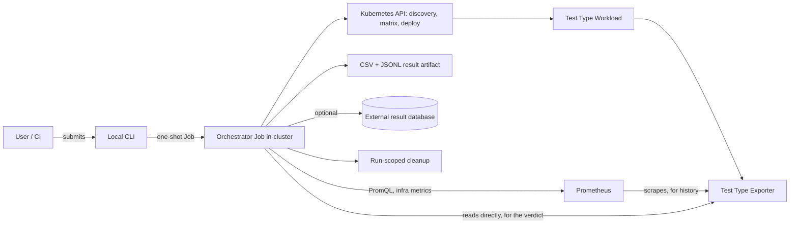
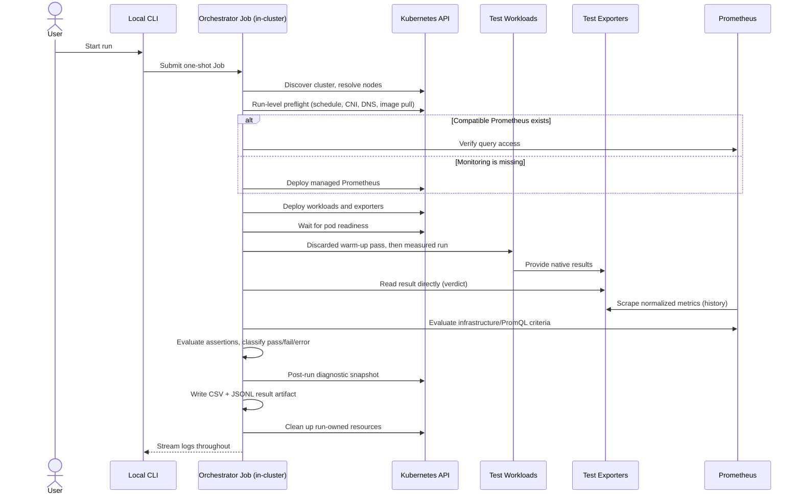
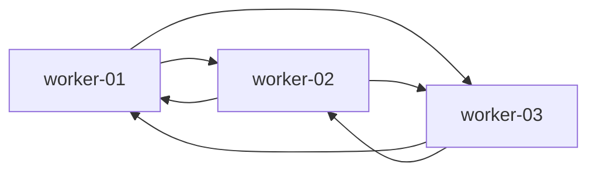

# test-orchestrator

## Overview

Test orchestration framework for functional and non-functional validation of Kubernetes clusters.

All architecture decisions live in a separate repository,
[test-orchestrator-adrs](../test-orchestrator-adrs/README.md) — this README describes what has
been **decided** there. Where something is still open, it says so and links to the owning ADR or
open question rather than guessing.

Main goals:

- Python-based orchestration, submitted from a local CLI and executed as a one-shot in-cluster Job
  ([ADR-01-06](../test-orchestrator-adrs/adrs/01-06-orchestrator-as-a-one-shot-in-cluster-job.md))
- Automatic Kubernetes discovery
- Node-to-node test execution
- Self-deployment of required test and monitoring components
- Optional integration with an existing Prometheus, with a managed fallback
  ([ADR-03-02](../test-orchestrator-adrs/adrs/03-02-prometheus-integration-modes.md))
- Common interfaces for different test types, with capability discovery
  ([ADR-02-01](../test-orchestrator-adrs/adrs/02-01-test-type-interface-with-capability-discovery.md))
- Human-readable pass criteria backed by PromQL queries
  ([ADR-02-05](../test-orchestrator-adrs/adrs/02-05-human-readable-validation-keywords-mapped-to-promql.md))
- Cluster preflight and pod-readiness checks before a test runs
  ([ADR-05-07](../test-orchestrator-adrs/adrs/05-07-cluster-preflight-and-pod-readiness-checks.md))
- A local, exportable result artifact on every run, database-optional
  ([ADR-05-09](../test-orchestrator-adrs/adrs/05-09-milestone-01-local-result-artifact.md))
- Documentation
    - User Guide
    - How Tos (Contribution Guide, Where is what, ...)

### Milestone-01 — first MVP scope

The first end-to-end slice is deliberately narrow
([ROADMAP.md](../test-orchestrator-adrs/ROADMAP.md#milestone-01--first-end-to-end-mvp)):

- One cluster
- A local CLI validates input and submits the one-shot orchestration Job
- Two explicitly named nodes, one directed `iperf2` UDP test, pod-network traffic, sequential
  execution
- A managed Prometheus instance observes completion, throughput, and packet loss
- The orchestrator evaluates minimum throughput and maximum packet loss
- The run reports pass, fail, or error, captures its minimal diagnostic record, and safely cleans
  up run-owned resources

Everything else below this point — test matrices beyond one pair, multiple test types, bounded
concurrency, durable storage, stable public interfaces — is real, decided architecture, but is not
what Milestone-01 builds. Each section says which milestone it belongs to.

Future milestones (see [ROADMAP.md](../test-orchestrator-adrs/ROADMAP.md) for the authoritative
list and exit criteria):

- **Milestone-02** — general matrices, node-selector modes, versioned YAML schema, canonical
  pluggable test-definition formats
- **Milestone-03** — `iperf3`, IRTT, additional metric capabilities
- **Milestone-04** — a relational database as the system of record, historical comparison
- **Milestone-05** — `v1` interface freeze, operator readiness
- **Milestone-06** — multi-cluster execution

## Motivation

Existing tools cover parts of the required workflow:

- `k8s-netperf`
  - Kubernetes network benchmarks
  - Multiple traffic generators
- `Testkube`
  - General test execution and workflow orchestration
- `ClusterLoader2` and `kube-burner`
  - Kubernetes load and scalability tests
- `K-Bench`
  - Control-plane and data-plane benchmarks

### Identified Gap

Required combination:

- Lightweight execution, nothing permanently installed in the cluster between runs
  ([ADR-01-06](../test-orchestrator-adrs/adrs/01-06-orchestrator-as-a-one-shot-in-cluster-job.md))
- Self-deployment of test and monitoring components
- Use of an existing Prometheus when available
- Automatic node discovery and placement
- Configurable node-to-node test matrices (Milestone-02)
- Human-readable validation criteria backed by PromQL
- Extensible test types and exporters
- A local result artifact on every run, with an optional durable database later
  ([ADR-05-09](../test-orchestrator-adrs/adrs/05-09-milestone-01-local-result-artifact.md),
  [ADR-05-06](../test-orchestrator-adrs/adrs/05-06-relational-database-as-the-system-of-record-for-results.md))
- Future cluster-to-cluster support

The project acts as an abstraction layer between a local CLI, an in-cluster orchestration Job,
Kubernetes test workloads, exporters, and Prometheus.

## Architecture



The CLI is the local entry point; it never talks to the test workloads or Prometheus itself. It
submits a Job and can disconnect and later reattach to stream its logs — the Job is a server-side
resource, not tied to the CLI's connection
([ADR-01-06](../test-orchestrator-adrs/adrs/01-06-orchestrator-as-a-one-shot-in-cluster-job.md)).
`--dry-run` stays fully local: it renders every manifest the run would need and submits nothing.

The Job itself contains the full orchestration logic — discovery, matrix building, deployment,
execution, and PromQL evaluation. **This is pure Python, never Robot Framework at runtime** — now
settled by the accepted
[ADR-04-05](../test-orchestrator-adrs/adrs/04-05-canonical-test-definition-model-with-pluggable-formats.md):
the orchestration library "must not know that a suite exists... must not know that YAML exists. It
consumes the canonical model only." Robot and YAML are both authoring formats that `parse()` into
that canonical model *before* the library ever runs — the library itself never invokes Robot's
runtime. ADR-01-06's "Robot execution" phrasing predates this clarification and should be read as
"execute the parsed test definition," not literally Robot Framework. For Milestone-01 specifically,
this is moot either way: the CLI takes its parameters directly (see
[Configuration](#configuration)), so no format parsing happens at all yet.

### Local CLI (entry point)

- Validates input and submits the one-shot orchestration Job
  ([ADR-01-06](../test-orchestrator-adrs/adrs/01-06-orchestrator-as-a-one-shot-in-cluster-job.md))
- `--dry-run` renders manifests locally and submits nothing
- Reattaches to an already-running Job to stream its logs, using the run's ownership labels to
  find it — works identically for an interactive invocation and a CI job checking on a run it
  submitted earlier
- Ships with a pinned default digest for the orchestrator's own image, matching its own release;
  overridable for air-gapped or policy-constrained clusters
  ([ADR-05-08](../test-orchestrator-adrs/adrs/05-08-container-image-strategy-for-the-orchestrator-itself.md))
- Distributed from, and installed against, the same `uv.lock` the orchestrator image is built from
  ([ADR-01-02](../test-orchestrator-adrs/adrs/01-02-python-as-the-orchestration-implementation-language.md))

### Orchestrator Job (in-cluster)

Responsibilities, all running inside the submitted Job:

- Discover the cluster, resolve node selectors, build the test matrix
- Run a run-level preflight (scheduling, CNI connectivity, DNS, image pull, node count) before
  deploying anything real
  ([ADR-05-07](../test-orchestrator-adrs/adrs/05-07-cluster-preflight-and-pod-readiness-checks.md))
- Deploy required test workloads and exporters, labeled as run-owned
  ([ADR-05-02](../test-orchestrator-adrs/adrs/05-02-run-scoped-resource-ownership-and-cleanup.md))
- Wait for pod readiness, then run a discarded warm-up measurement pass by default before the
  measured run
  ([ADR-04-04](../test-orchestrator-adrs/adrs/04-04-test-execution-concurrency-strategy.md))
- Execute tests and read completed results directly from each exporter for the verdict, while
  Prometheus scrapes the same exporter for history
  ([ADR-03-01](../test-orchestrator-adrs/adrs/03-01-metric-delivery-for-short-lived-tests.md))
- Evaluate pass criteria as PromQL queries (or an equivalent direct-read expression) against the
  values it read, never re-deriving them later
  ([ADR-02-05](../test-orchestrator-adrs/adrs/02-05-human-readable-validation-keywords-mapped-to-promql.md))
- Capture a post-run diagnostic snapshot before cleanup
  ([ADR-05-07](../test-orchestrator-adrs/adrs/05-07-cluster-preflight-and-pod-readiness-checks.md))
- Always write a local CSV + JSONL result as the run's primary output; optionally also write to an
  external result database when one is configured and reachable — never a hard precondition
  ([ADR-05-09](../test-orchestrator-adrs/adrs/05-09-milestone-01-local-result-artifact.md),
  [ADR-01-06](../test-orchestrator-adrs/adrs/01-06-orchestrator-as-a-one-shot-in-cluster-job.md))
- Clean up every run-owned resource, retained on failure for inspection
  ([ADR-05-02](../test-orchestrator-adrs/adrs/05-02-run-scoped-resource-ownership-and-cleanup.md))

### Test Type Interface

Every test type is a plugin behind a stable interface
([ADR-02-01](../test-orchestrator-adrs/adrs/02-01-test-type-interface-with-capability-discovery.md),
detailed in
[designs/test-type-interface.md](../test-orchestrator-adrs/designs/test-type-interface.md)):

```python
class TestType(Protocol):
    name: str                      # "iperf2", "irtt"

    def images(self) -> ImagePair: ...
    def parameter_schema(self) -> ParameterSchema: ...
    def workload(self, params: TestParameters) -> WorkloadSpec: ...
    def capabilities(
        self, params: TestParameters, environment: ClusterFacts | None = None
    ) -> set[Capability]: ...
    def start(self, deployed: DeployedWorkload) -> None: ...
    def is_complete(self, deployed: DeployedWorkload) -> bool: ...
    def exporter(self) -> ExporterSpec: ...
    def cleanup(self, deployed: DeployedWorkload) -> None: ...
```

`capabilities()` takes the parameter set and an optional `environment` (cluster facts such as
clock synchronization, needed by later test types like IRTT — `iperf2` ignores it). Capabilities
are declared as data, not inferred from code, so they can be listed to the user without executing
anything.

**Milestone-01 does not cross-check requested criteria against `capabilities()` before deploying.**
The test writer is expected to know which test type, parameters, and criteria go together. An
unsupported criterion is not rejected up front in Milestone-01; it runs, produces no matching
metric, and surfaces as an `error` — never a `pass`
([ADR-05-05](../test-orchestrator-adrs/adrs/05-05-failure-and-error-categories.md)). The
fail-fast pre-deployment check is deferred to **Milestone-02**, which builds the YAML/canonical
validation layer this check rides on anyway.

Milestone-01 implements `iperf2`, UDP only: `parameter_schema()` is `protocol`, `targetBandwidth`,
`duration`; `capabilities({protocol: udp})` is `{THROUGHPUT, PACKET_LOSS, JITTER}`.

### Exporter Interface

One dedicated exporter per test type, run as a sidecar alongside the test workload — **each pod
exports its own view**, not one exporter speaking for both endpoints of a pair
([ADR-02-02](../test-orchestrator-adrs/adrs/02-02-one-dedicated-exporter-per-test-type.md)). In
addition, the standard
[Prometheus node exporter](https://github.com/prometheus/node_exporter) provides node-level
metrics, reusing an already-present instance where the cluster has one rather than deploying a
duplicate ([ADR-03-02](../test-orchestrator-adrs/adrs/03-02-prometheus-integration-modes.md)).

Responsibilities:

- Parse native tool results
- Expose the normalized metric set with required labels
- Preserve useful tool-specific metrics under a clearly separated name prefix
- Report completion state explicitly, so "test failed", "test never ran", and "metric absent" are
  distinguishable

Required labels
([ADR-02-04](../test-orchestrator-adrs/adrs/02-04-required-metric-labels-and-run-identity.md)):

- `run_id` — sortable `<timestamp>-<short-random>`, stable for the whole run
- `test_id` — one source/target/parameter combination, stable across repetitions
- `repetition` — a separate label, applies once Milestone-04 adds repetitions
- `test_type`
- `source_node` / `target_node`, `source_pod` / `target_pod`, `source_ip` / `target_ip`
- `protocol` — `tcp` or `udp`
- `stat` — latency metrics only, one of `min`/`avg`/`max`

Normalized metrics
([ADR-02-03](../test-orchestrator-adrs/adrs/02-03-normalized-metric-names-and-base-units.md)):

```text
test_orchestrator_test_completed
test_orchestrator_execution_errors_total
test_orchestrator_throughput_bits_per_second
test_orchestrator_packet_loss_percent          # deliberate deviation from base-unit convention
test_orchestrator_jitter_seconds
test_orchestrator_latency_one_way_seconds      # separate from round-trip, not a direction label
test_orchestrator_latency_round_trip_seconds
```

Base-unit rules: time in seconds, throughput in bits per second (decimal prefixes), data in bytes,
never milliseconds/megabits/mebibytes in a metric name. Final results are gauges, not counters
requiring `rate()`. Latency distributions, once a test type produces one, export both a native
Prometheus histogram from raw samples and the tool's own precomputed quantiles as distinctly named
metrics — not Phase 1 for `iperf2`, which declares no latency capability at all. Not every test
type provides every metric; capability declarations state which.

### Validation Interface

A pass criterion is **one canonical record** — `metric`, `statistic` (optional), `comparison`
(`atLeast`/`atMost`/`exactly`), `threshold`, `unit`, `scope` (reserved) — and every authoring
format is a rendering of that record, never a definition of its own
([ADR-02-05](../test-orchestrator-adrs/adrs/02-05-human-readable-validation-keywords-mapped-to-promql.md)).
No criterion may exist in only one format.

Robot surface: `<Statistic>? <Metric> Should Be <Comparison> <Value> <Unit>` — the leading
adjective is always the statistic, the comparison is always explicit:

```robot
Throughput Should Be      At Least    950    megabits per second
Packet Loss Should Be     At Most     0      percent
```

These are the two Milestone-01 keywords — the only criteria `iperf2` over UDP can produce. Neither
carries a `stat`, so neither takes a statistic yet; that becomes reachable with the first latency
keyword (Milestone-03).

YAML surface — the same record, unit as a field, **never encoded in the key name**:

```yaml
validation:
  - metric: throughput
    comparison: atLeast
    value: 950
    unit: megabitsPerSecond
  - metric: packetLoss
    comparison: atMost
    value: 0
    unit: percent
```

Assertion semantics:

- Criteria are universally quantified over the matrix — a criterion passes only if it holds for
  every expected pair, and the expected set comes from the matrix the orchestrator built, never
  from whatever the query happened to return.
- Absence of data is never a pass.
- The equivalent PromQL (or direct-read expression) is logged and recorded with the assertion, so
  a disputed result is reproducible by hand.
- Failure messages restate the criterion, count violations before detail, list the worst ten
  offending pairs with values in the user's own unit, and list errors separately from failures.

## Deployment



### Monitoring Modes

([ADR-03-02](../test-orchestrator-adrs/adrs/03-02-prometheus-integration-modes.md))

#### Managed

- Deploy required Prometheus components, reusing an already-present node-exporter /
  kube-state-metrics rather than deploying a duplicate
- Deploy required exporters, configure scraping automatically
- Label resources with run ownership
- **Kept by default after the run**; removal requires an explicit flag — results are also always
  archived locally, so removal is never the only copy lost

#### Existing

- Use a configured or detected Prometheus endpoint
- Verify authentication (bearer token only in Milestone-01) and query access before the run
- Scrape configuration tries Prometheus Operator CRDs first, falls back to annotation-based
  discovery; never a push-based mechanism
- Expose test exporters for scraping; modify no unrelated resources

#### Auto

- **The Milestone-01 default.** Prefers a compatible existing installation, falls back to
  `managed`. The resolved mode and endpoint are logged prominently, so the user always knows which
  Prometheus produced their results.

## Test Matrix

**Milestone-01 runs exactly one directed pair** between two explicitly named nodes — no matrix
construction yet.

The full matrix mode set below is decided architecture but is **Milestone-02** scope
([ADR-04-01](../test-orchestrator-adrs/adrs/04-01-test-matrix-modes-and-node-selection.md),
still `proposed`):

- `one-to-one`, `one-to-many`, `many-to-one`, `all-to-all`, `one-to-all`, `all-to-one`
- Node selection by exact name (Milestone-01), Kubernetes labels, topology labels, or automatic
  selection (Milestone-02)
- Same-node pairs excluded by default



*Illustrates the eventual `all-to-all` mode across three nodes — not a Milestone-01 shape.*

Execution strategy once a matrix exists (Milestone-02,
[ADR-04-04](../test-orchestrator-adrs/adrs/04-04-test-execution-concurrency-strategy.md)):
bounded concurrency with node exclusivity by default (no node in more than one concurrent test),
user-overridable per run to sequential or unbounded for tests where contention is itself the
point, capped by a configurable `maxConcurrency`, informed by topology labels to minimize
shared-path contention. The effective concurrency is always recorded in run metadata.

## Configuration

**Milestone-01 takes its two node names and test parameters directly** (CLI flags or a minimal
file) — building out the schema below is **Milestone-02** work
([ADR-04-02](../test-orchestrator-adrs/adrs/04-02-configuration-sources-and-precedence.md),
[ADR-04-03](../test-orchestrator-adrs/adrs/04-03-versioned-yaml-configuration-schema.md), both
still `proposed`), even though the architecture behind it is now decided: this YAML *is* the
canonical test definition model itself, not a rendering of something more abstract
([ADR-04-05](../test-orchestrator-adrs/adrs/04-05-canonical-test-definition-model-with-pluggable-formats.md),
accepted).

### YAML Example (Milestone-02 target shape, canonical model)

```yaml
apiVersion: test-orchestrator/v1alpha1
kind: NetworkTest

metadata:
  name: all-to-all-1g

execution:
  matrix: all-to-all
  repetitions: 1
  cleanup: true

placement:
  nodeSelector:
    node-role.kubernetes.io/worker: ""
  excludeSameNode: true

test:
  type: iperf2
  protocol: udp
  duration: 30s
  targetBandwidth: 1G

monitoring:
  mode: auto
  existingPrometheusUrl: null

validation:
  - metric: packetLoss
    comparison: atMost
    value: 0
    unit: percent
  - metric: throughput
    comparison: atLeast
    value: 950
    unit: megabitsPerSecond
  - metric: latency
    statistic: max
    comparison: atMost
    value: 10
    unit: microseconds

results:
  directory: ./results
  formats: [csv, jsonl]
```

### Robot Example

Robot is a client format of the canonical model
([ADR-04-05](../test-orchestrator-adrs/adrs/04-05-canonical-test-definition-model-with-pluggable-formats.md),
accepted) — a suite like this `parse()`s into the same YAML-shaped record shown above, restricted
to the declarative subset (parameters and pass-criteria calls; named templates for reusable
groups). It is never executed directly by the orchestrator; whatever format is used, the Job runs
against the parsed canonical model. This is Milestone-02 build-out, not Milestone-01, which takes
its parameters directly with no format parsing at all.

```robot
*** Settings ***
Documentation       Minimal example for a directed iperf2 UDP test.
Resource            resources/TestOrchestrator.resource

Suite Setup         Prepare Test Environment    prometheus=auto
Suite Teardown      Archive Results And Cleanup


*** Variables ***
${TEST_TYPE}             iperf2
${PROTOCOL}              udp
${SOURCE_NODE}           worker-01
${TARGET_NODE}           worker-02
${TARGET_BANDWIDTH}      1G
${TEST_DURATION}         30s


*** Test Cases ***
Directed UDP Network Test
    Run Network Test
    ...    type=${TEST_TYPE}
    ...    protocol=${PROTOCOL}
    ...    source_node=${SOURCE_NODE}
    ...    target_node=${TARGET_NODE}
    ...    bandwidth=${TARGET_BANDWIDTH}
    ...    duration=${TEST_DURATION}

    Throughput Should Be      At Least    950    megabits per second
    Packet Loss Should Be     At Most     0      percent
```

Suggested implementation split:

```text
resources/TestOrchestrator.resource
libraries/TestOrchestratorLibrary.py
```

## Failure and Error Categories

([ADR-05-05](../test-orchestrator-adrs/adrs/05-05-failure-and-error-categories.md))

| Category | Meaning | Robot outcome |
| --- | --- | --- |
| `pass` | Measured, criteria met | PASS |
| `fail` | Measured, criteria not met | FAIL, names the offending pairs and values |
| `error` | Not validly measured | FAIL, clearly marked as an error, not a network finding |
| `config_error` | Invalid request, detected pre-deployment | FAIL, before any resource is created |
| `skipped` | Deliberately not run | SKIP |

- Absence of data is always an `error`, never a `pass`.
- A run with any `error`/`fail` pairs cannot report an overall pass unless every such pair is
  explicitly marked `optional: true` at authoring time — visible in the report either way, never
  silent.
- No automatic retries by default; opt in with `retry: true`, up to 3 attempts, `error` category
  only — a `fail` is a real finding about the network and is never retried.
- Errors carry a machine-readable sub-category (`scheduling`, `image_pull`, `tool_execution`,
  `exporter_parse`, `metrics_missing`, `prometheus_unreachable`, `timeout`, `cleanup`).

## Result Artifacts

**Milestone-01** writes CSV and JSONL, both, automatically, on every run — from the orchestrator's
own in-memory result objects, no database required
([ADR-05-09](../test-orchestrator-adrs/adrs/05-09-milestone-01-local-result-artifact.md)). Two
grains, matching the eventual database schema so the file format does not reshape later:

- One record per completed test — identity, parameters, every normalized metric value, completion
  state, error category
- One record per assertion evaluated against that test — criterion, measured value, unit,
  threshold, comparison, verdict; written for every assertion, passing or failing

Supporting/infrastructure metrics and retention policy are explicitly out of scope for
Milestone-01 — both become **Milestone-04** questions once a database exists
([ADR-05-06](../test-orchestrator-adrs/adrs/05-06-relational-database-as-the-system-of-record-for-results.md)).

Robot Framework never drives execution (see [Architecture](#architecture)) and Milestone-01 has no
Robot suite involved at all, so there is no `output.xml`/`log.html`/`report.html` to reconcile with
this artifact — the CSV/JSONL pair is the only result Milestone-01 produces.

## Container Images and Packaging

- **Test-workload and exporter images** — one per test type, built and published under
  `ghcr.io/test-orchestrator/<image-name>`, pinned by digest (recorded in run metadata and the
  result artifact, never by tag), signed with provenance attestation, Alpine-based
  ([ADR-05-04](../test-orchestrator-adrs/adrs/05-04-container-image-strategy-for-test-workloads.md))
- **The orchestrator's own image** — `ghcr.io/test-orchestrator/orchestrator`, same digest-pinning
  and signing conventions, but **`python:3.12-slim` (Debian-based)**, not Alpine, for glibc wheel
  compatibility with the Python dependency ecosystem
  ([ADR-05-08](../test-orchestrator-adrs/adrs/05-08-container-image-strategy-for-the-orchestrator-itself.md))
- Both the CLI distribution and the orchestrator image build from **one `uv.lock` at the
  repository root**, so a released CLI version and its matching orchestrator image can never
  resolve different dependency sets independently
  ([ADR-01-02](../test-orchestrator-adrs/adrs/01-02-python-as-the-orchestration-implementation-language.md))
- Minimum Python **3.12+**; `kubernetes` client library pinned to **1.35+**
- All image references are overridable per run or installation, for air-gapped or
  policy-constrained clusters

## Interface Stability

([ADR-06-01](../test-orchestrator-adrs/adrs/06-01-interface-versioning-and-stability-guarantees.md))

- Every interface (orchestration, test type, exporter, metric, YAML schema, keyword vocabulary) is
  `v1alpha1` through Milestone-01 — breaking changes are expected, nothing is promised stable yet
- Milestone-02 freezes most interfaces at `v1`; the test type and exporter interfaces wait for a
  second test type (IRTT, Milestone-03) to prove the contract general before freezing
- Every breaking change to a frozen interface requires an ADR, plus a deprecation window of at
  least one minor release
- `--version` surfaces every interface's current version at runtime

## Roadmap

Full detail, exit criteria, and current status live in
[ROADMAP.md](../test-orchestrator-adrs/ROADMAP.md) — summarized here, not duplicated:

- **Milestone-00 — Architecture ready** (closed): the minimum architectural contract for the first
  MVP is decided
- **Milestone-01 — First end-to-end MVP** (current): the scope described throughout this document
- **Milestone-02 — General matrices and authoring formats**: full matrix modes, configuration
  precedence, versioned YAML schema, canonical pluggable test-definition formats
- **Milestone-03 — Additional test types**: `iperf3`, IRTT, extended metric capabilities
- **Milestone-04 — Durable results**: relational database as system of record, historical
  comparison, regression detection
- **Milestone-05 — Stable public interfaces**: `v1` freeze, operator readiness
- **Milestone-06 — Multi-cluster execution**: cross-cluster connectivity, security, and result
  correlation

`TRex` and a Kubernetes Operator remain backlog items, tentatively Milestone-05/06, not actively
designed against until scheduled.

## Open Questions

Architecture decisions and open questions are tracked in the ADR repository, not duplicated here:

- [test-orchestrator-adrs/README.md](../test-orchestrator-adrs/README.md) — ADR index
- [test-orchestrator-adrs/OPEN-QUESTIONS.md](../test-orchestrator-adrs/OPEN-QUESTIONS.md) — every
  unresolved question, with stable IDs
- [test-orchestrator-adrs/ROADMAP.md](../test-orchestrator-adrs/ROADMAP.md) — milestones and exit
  criteria

The implementation-level question previously flagged here — whether the Job's execution engine
invokes Robot Framework at runtime — is **resolved**: it does not.
[ADR-04-05](../test-orchestrator-adrs/adrs/04-05-canonical-test-definition-model-with-pluggable-formats.md)
is now accepted; the orchestration library consumes the canonical model only, and Robot is purely a
`parse()`/`render()` client format, never invoked at runtime. See [Architecture](#architecture).

## Related Projects

- [k8s-netperf](https://github.com/cloud-bulldozer/k8s-netperf)
- [Testkube](https://github.com/kubeshop/testkube)
- [ClusterLoader2](https://github.com/kubernetes/perf-tests/tree/master/clusterloader2)
- [K-Bench](https://github.com/vmware-tanzu/k-bench)
- [Robot Framework](https://robotframework.org/)
- [Prometheus](https://prometheus.io/)
